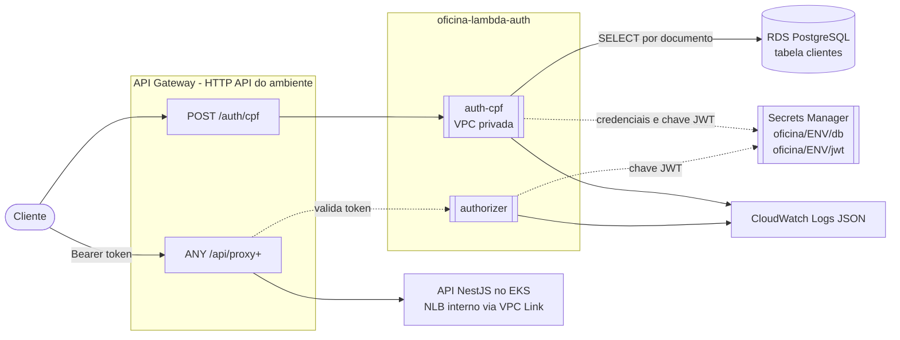
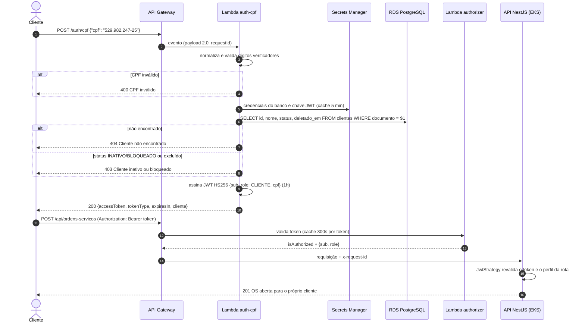

# oficina-lambda-auth

Funções serverless (AWS Lambda, Node.js 22 + TypeScript) de autenticação da **Oficina Mecânica**, projeto do Tech Challenge da Pós-Tech em Arquitetura de Software (FIAP), fase 3.

| Função | Gatilho | Responsabilidade |
| --- | --- | --- |
| `oficina-auth-cpf-<env>` | `POST /auth/cpf` no API Gateway | Valida o CPF, consulta existência e status do cliente no RDS e devolve um JWT para consumir as APIs protegidas |
| `oficina-authorizer-<env>` | Lambda Authorizer das rotas `ANY /api/{proxy+}` | Valida assinatura, expiração e perfil do token (clientes e funcionários) antes de a requisição chegar ao EKS |

| Repositório | Responsabilidade |
| --- | --- |
| [tech-challenge](https://github.com/Guribeiro/tech-challenge) | Aplicação NestJS no EKS (revalida o JWT e aplica as regras de perfil por rota) |
| [oficina-infra-k8s](https://github.com/Guribeiro/oficina-infra-k8s) | VPC, EKS, ECR e API Gateway (associa o authorizer às rotas) |
| [oficina-infra-db](https://github.com/Guribeiro/oficina-infra-db) | RDS PostgreSQL e segredos `oficina/<env>/db` e `oficina/<env>/jwt` |
| **oficina-lambda-auth** (este) | Funções de autenticação e rota `POST /auth/cpf` |

## Tecnologias

- Node.js 22, TypeScript, esbuild (um bundle ESM por função)
- `jose` (JWT HS256), `pg` (PostgreSQL), AWS SDK v3 (Secrets Manager)
- Vitest (unitários e integração com PostgreSQL), ESLint
- Terraform 1.13 (Lambda, CloudWatch Logs, integração e rota no API Gateway)
- GitHub Actions (lint, testes, build, plan, deploy e smoke test por ambiente)
- New Relic Lambda layer (opcional)

## Arquitetura



### Fluxo de autenticação por CPF



### Contratos

**Requisição e respostas de `POST /auth/cpf`**

```http
POST /auth/cpf
Content-Type: application/json

{ "cpf": "529.982.247-25" }
```

| Status | Corpo |
| --- | --- |
| 200 | `{ "accessToken": "<jwt>", "tokenType": "Bearer", "expiresIn": 3600, "cliente": { "id": "...", "nome": "..." } }` |
| 400 | `{ "statusCode": 400, "message": "CPF inválido." }` (formato, dígitos verificadores ou corpo inválido) |
| 403 | `{ "statusCode": 403, "message": "Cliente inativo ou bloqueado." }` |
| 404 | `{ "statusCode": 404, "message": "Cliente não encontrado." }` |
| 500 | `{ "statusCode": 500, "message": "Erro interno ao autenticar." }` (detalhes apenas no log) |

**Token:** JWT HS256 com `{ sub: <id do cliente>, role: "CLIENTE", cpf, iss: "oficina-lambda-auth", iat, exp }`, assinado com o segredo `oficina/<env>/jwt`, o mesmo usado pela API para os tokens de funcionários. A compatibilidade com o `@nestjs/jwt` da API é coberta por testes.

**Authorizer:** resposta simples do HTTP API (`isAuthorized` + contexto `sub` e `role`). Requisições sem cabeçalho `Authorization` são rejeitadas pelo próprio API Gateway com 401, e tokens inválidos com 403. A API NestJS revalida o token (defesa em profundidade) e aplica os perfis exigidos por rota.

**CPFs de demonstração** (seed da aplicação): `52998224725` (ativo), `11144477735` (bloqueado) e `93541134780` (inativo).

### Logs

Logs JSON em uma linha por evento, no mesmo formato da API (`level`, `timestamp`, `service`, `env`, `request_id`, `message`). O `request_id` é o `requestId` do API Gateway, que o gateway também repassa à API no cabeçalho `x-request-id`; o CPF aparece apenas mascarado (`529.***.***-25`).

## Estrutura

```text
src/
├── domain/        # CPF, caso de uso AutenticarClientePorCpf e contrato de verificação de token
├── infra/         # Secrets Manager (cache), JWT (jose), repositório PostgreSQL, logger
└── handlers/      # auth-cpf e authorizer (adaptadores do API Gateway)
test/              # unitários + integração (PostgreSQL)
infra/             # Terraform das funções e da rota POST /auth/cpf
scripts/           # build (esbuild) e tf.sh
```

## Execução local

```bash
npm ci
npm run lint && npm run typecheck
npm test                 # unitários
npm run build            # dist/auth-cpf e dist/authorizer

# Integração com o PostgreSQL da aplicação (docker compose do tech-challenge, com seed)
INTEGRATION_DB_HOST=localhost INTEGRATION_DB_PASSWORD=postgres DB_SSL=false npm test
```

## Deploy

Pré-requisitos, na ordem: stack `platform` e stack `environment` do `oficina-infra-k8s` (HTTP API do ambiente) e `oficina-infra-db` (segredos e security group de acesso ao banco).

```bash
export TF_STATE_BUCKET=oficina-tfstate-<account_id>
./scripts/tf.sh hml plan
./scripts/tf.sh hml apply
./scripts/tf.sh hml output     # auth_url

curl -X POST "$(terraform -chdir=infra output -raw auth_url)" \
  -H 'content-type: application/json' -d '{"cpf":"52998224725"}'
```

Depois do primeiro deploy, reaplique a stack `environment` do `oficina-infra-k8s` (ou rode o `workflow_dispatch` dela) para que o authorizer seja associado às rotas protegidas.

As funções usam a role `LabRole` do AWS Learner Lab (nenhuma role IAM é criada). A `auth-cpf` roda nas subnets privadas com o security group de clientes do banco e verifica o certificado TLS do RDS usando `NODE_EXTRA_CA_CERTS=/var/runtime/ca-cert.pem`.

## CI/CD

Workflow [`.github/workflows/ci-cd.yml`](.github/workflows/ci-cd.yml):

| Evento | Execução |
| --- | --- |
| Pull request para `develop` ou `main` | `validate` (lint, typecheck, testes com cobertura, build, terraform fmt/validate, tflint) e `plan` do ambiente de destino |
| Push na `develop` | deploy em hml e smoke test (`POST /auth/cpf` com CPF inválido deve retornar 400) |
| Push na `main` | deploy em prd e smoke test |
| `workflow_dispatch` | plan, apply ou destroy de um ambiente |

A `main` é protegida: alterações entram somente por pull request com o check `validate` aprovado. Os jobs que acessam a AWS só executam quando a variável `TF_STATE_BUCKET` está configurada.

### Configuração do GitHub

| Escopo | Nome | Descrição |
| --- | --- | --- |
| Environments `homologacao`/`producao` (secrets) | `AWS_ACCESS_KEY_ID`, `AWS_SECRET_ACCESS_KEY`, `AWS_SESSION_TOKEN` | Credenciais do Learner Lab |
| Environments (secret, opcional) | `NEW_RELIC_LICENSE_KEY` | Licença usada pela extensão da layer New Relic |
| Repositório (variables) | `TF_STATE_BUCKET`, `AWS_REGION` | Bucket do state e região |
| Repositório (variables, opcionais) | `NEW_RELIC_LAYER_ARN`, `NEW_RELIC_ACCOUNT_ID` | Habilitam a instrumentação New Relic das funções |

## Deploys ativos e links

| Ambiente | API Gateway | Swagger | Autenticação por CPF |
| --- | --- | --- | --- |
| Homologação (`develop`) | https://0bagr12oql.execute-api.us-east-1.amazonaws.com | [/docs](https://0bagr12oql.execute-api.us-east-1.amazonaws.com/docs) | `POST https://0bagr12oql.execute-api.us-east-1.amazonaws.com/auth/cpf` |
| Produção (`main`) | https://cvqm7rpmdg.execute-api.us-east-1.amazonaws.com | [/docs](https://cvqm7rpmdg.execute-api.us-east-1.amazonaws.com/docs) | `POST https://cvqm7rpmdg.execute-api.us-east-1.amazonaws.com/auth/cpf` |

URLs da sessão de 16/11/2026. O ambiente roda no AWS Learner Lab e é destruído e recriado entre sessões (`scripts/bringup.sh` do [oficina-infra-k8s](https://github.com/Guribeiro/oficina-infra-k8s)), o que gera novas URLs.

- Coleção Postman (autenticação por CPF, authorizer e APIs protegidas): [oficina-fase3.postman_collection.json](https://github.com/Guribeiro/tech-challenge/blob/main/docs/postman/oficina-fase3.postman_collection.json)
- Documentação arquitetural (componentes, sequências, RFCs, ADRs, modelo de dados): [tech-challenge/docs](https://github.com/Guribeiro/tech-challenge/tree/main/docs)
- Contrato de `POST /auth/cpf` e do authorizer: seção *Arquitetura* acima e [RFC 0003](https://github.com/Guribeiro/tech-challenge/blob/main/docs/rfcs/0003-autenticacao-lambda-jwt.md)